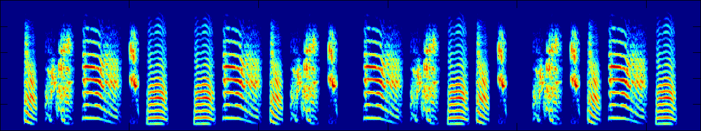
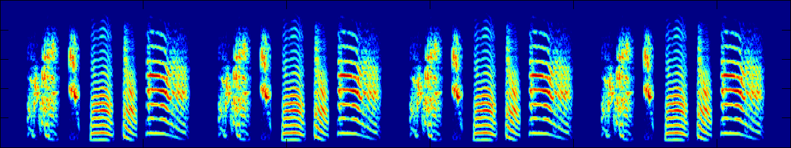

This week's lecture reading was about vocal learning, and in the lecture I focussed on grammar learning. The workshop picks up on both topics, and looks at sequence-learning biases in vocal learners. 

For this week's workshop, read [James & Sakata (2017)](https://doi.org/10.1016/j.cub.2017.10.019) and [Tchernichovski & Lipkind (2017)](https://doi.org/10.1016/j.cub.2017.10.041), which is a helpful one-page summary/comment on the James & Sakata paper. You could also watch this brief video explainer of the experiment:

<video width="320" height="240" controls>
  <source src="https://youtu.be/heMy6dlWvkQ?si=W9QivHbcH1LMM2uN" type="video/mp4">
</video>

James & Sakata is fairly technical; **don't worry about the technicalities of the statistical analysis** (unless you are in to that kind of thing), but try to get the gist of what they are describing; the Tchernichovski & Lipkind comment is quite helpful for this too.

To get a feel for natural "wild-type" zebra finch song, have a listen to the songs below - 6 wild-type song examples of naturally-tutored birds: [Wild-type song 1](feher_materials/wt1.wav), [Wild-type song 2](feher_materials/wt2.wav), [Wild-type song 3](feher_materials/wt3.wav), [Wild-type song 4](feher_materials/wt4.wav), [Wild-type song 5](feher_materials/wt5.wav), [Wild-type song 6](feher_materials/wt6.wav). You could compare these to the songs produced by sol-called "isolate" birds who are raised without any song input, and produce songs that are distinctively different (to the expert ear!): they are a bit longer, they have more repetition of individual syllables rather than repeating the entire syllable sequence, and are generally a bit more screechy. [Isolate song A](feher_materials/songA.mp3), [Isolate song B](feher_materials/songB.mp3), [Isolate song C](feher_materials/songC.mp3). 

To get a sense of the unstructured training data the experimentally-tutored birds from James & Sakata were trained on, click on this spectrogram to listen to 4 examples of 5-syllable songs - note that the syllables are in a different order every time. 

And here's a synthesised sample of 4 repetitions of a song using 5 syllables in a consistent order.

And here are two example songs sung by their experimentally-tutored birds: the common [b-e-a-d song](james_materials/pu17pu18_BEAD.wav), and a less typical [d-b-a-e-a](james_materials/r28r78_DBAEA.wav) song.

For the second question below, you need some example song syllables to reconstruct what kind of songs the experimentally-produced birds might sing - here are your 5 syllables.
- [Syllable a](james_materials/Tutor_A.wav) (short duration, lower pitch)
- [Syllable b](james_materials/Tutor_B.wav) (medium duration, higher pitch)
- [Syllable c](james_materials/Tutor_C.wav) (medium duration, lower pitch)
- [Syllable d](james_materials/Tutor_D.wav) (longest duration, medium pitch)
- [Syllable e](james_materials/Tutor_E.wav) (shortest duration, highest pitch)

Questions:
- What is the James & Sakata paper about? What did they do? What did they find?
- One of their results relates to how syllable duration and frequency (pitch) influence the position of syllables in songs (Figures 2C and 2D in the paper) - syllables in the middle tend to differ systematically on these features from syllables at the end. Based on these results, where would you expect syllables a-e might be most likely to appear? You might not be able to confidently guess for all syllables. Does this correspond to what they show in Figure 2B in terms of the positional preferences of these syllable-types?
- Based on their findings, which of the following syllable sequences do you thing would be most likely to be sung by one of their birds, and why? e-d-b-e, c-a-b-e-d, c-e-a-d.
- What aspect of their findings strikes you as most interesting or surprising from the perspective of someone interested in human language? Or if you think these results aren't relevant to understanding human language, why not?
- If you can imagine running similar experiments with humans, what do you think would happen? How different would the methods have to be to show interesting results? This question is intended to be about the factors you think are crucial in understanding human language transmission, rather than the ethical issues!

## Acknowledgments

[Dr. Logan S. James](https://logansjames.github.io) very kindly provided the tutor stimuli and example songs above, and [Dr. Olga Fehér](https://warwick.ac.uk/fac/sci/psych/people/ofeher/) shared the wild-type and isolate zebra finch songs. 

## References

[James, L. S., & Sakata, J. T. (2017). Learning Biases Underlie "Universals" in Avian Vocal Sequencing. *Current Biology, 27*, 3676-3682.](https://doi.org/10.1016/j.cub.2017.10.019)

[Tchernichovski, O., & Lipkind, D. (2017). Animal Communication: Origins of Sequential Structure in Birdsong. *Current Biology, 27*, R1268-R1269.](https://doi.org/10.1016/j.cub.2017.10.041)

## Re-use

All aspects of this work are licensed under a [Creative Commons Attribution 4.0 International License](http://creativecommons.org/licenses/by/4.0/).
